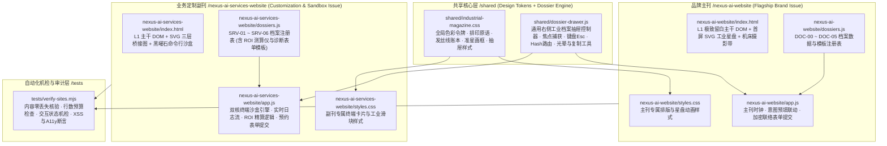
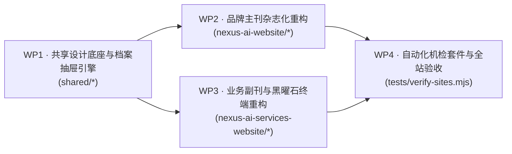

# 依然智枢 (YIRAN NEXUS) 官网重构 · 分包与 Coding 实施计划文档

> **【致执行模型 DeepSeek-V4 的执行说明】**
> 1. 请先阅读本文件与同目录下的 [WEBSITE-REPLAN.md](file:///Users/mon3xey/projects/company/WEBSITE-REPLAN.md)、[MASTER.md](file:///Users/mon3xey/projects/company/design-system/yiran-nexus/MASTER.md)，以及现网源码（`nexus-ai-website/*` 与 `nexus-ai-services-website/*`）以提取全部原始文案与交互逻辑。
> 2. 严格按本文档依次完成 **WP1（`shared/*`）→ WP2（`nexus-ai-website/*`）→ WP3（`nexus-ai-services-website/*`）→ WP4（自检与收尾）** 的全部代码编写，严禁使用占位符（`TODO`/`FIXME`/省略号）或删减任何原始业务文案、客户名录、电话邮箱与备案号。
> 3. 完成后将由验收方按照本文档「四、 交付与验收标准（Acceptance Criteria）」进行逐项硬性验收。

> **关联需求与设计基线**：[WEBSITE-REPLAN.md](file:///Users/mon3xey/projects/company/WEBSITE-REPLAN.md) · [MASTER.md](file:///Users/mon3xey/projects/company/design-system/yiran-nexus/MASTER.md)  
> **架构红线**：低耦合高内聚 · 单业务源码文件严格 `< 1000` 行（目标 `< 550` 行） · 零外部重框架依赖（移除 Tailwind CDN / Three.js / FontAwesome） · 100% 原始业务内容与交互能力无损保留。

---

## 一、 目标代码架构与模块边界设计

为彻底解决现网两套页面样式割裂、HTML 与巨量文案/逻辑耦合堆砌的问题，采用 **「1 个共享核心层 (`shared/`) + 2 个独立站点应用层 (`nexus-ai-website/` 与 `nexus-ai-services-website/`) + 1 套机检测试层 (`tests/`)」** 的高内聚、低耦合架构：



### 模块规模预算与职责清单（严格受控于 `< 1000` 行红线）

| 文件路径 | 所属模块 | 单一职责说明 | 预计行数 | 上限红线 |
| :--- | :--- | :--- | :---: | :---: |
| `shared/industrial-magazine.css` | 共享样式底座 | CSS 变量、字体族、`.site-head`、1:3/5:7 杂志网格、`.ledger-row`、`.mark`、`.hero-frame`、`.band`、`.cursor-glow`、`.dossier-drawer` | ~380 行 | 600 行 |
| `shared/dossier-drawer.js` | 共享交互底座 | `NexusDossier` 抽屉生命周期（打开/关闭/上下篇切换/Esc/遮罩/Hash深链/焦点恢复）、`.reveal` 观察器、`.cursor-glow` 跟随、`copyText()` | ~250 行 | 500 行 |
| `nexus-ai-website/index.html` | 主刊视图层 | 主刊 L1 极简主干 HTML 结构（00 首屏星盘 ~ 05 直联台）与通用抽屉挂载容器 | ~360 行 | 600 行 |
| `nexus-ai-website/styles.css` | 主刊样式层 | `@import "../shared/industrial-magazine.css"` + 主刊首屏 SVG 星盘与 POLE A/B 刻度样式 | ~160 行 | 400 行 |
| `nexus-ai-website/dossiers.js` | 主刊档案数据层 | `DOC-00` 至 `DOC-05` 共 6 份结构化工业档案定义（含三大信仰、双翼规格、5大纪元、10家客户、IR备忘录与联络表单） | ~310 行 | 600 行 |
| `nexus-ai-website/app.js` | 主刊控制层 | 注册主刊档案、`UTC+8` 实时时钟、`selectIntent(intent)` 唤起 `DOC-05` 并预填意图、`handleFormSubmit(e)` | ~130 行 | 350 行 |
| `nexus-ai-services-website/index.html` | 副刊视图层 | 副刊 L1 主干 HTML（00 SVG三层桥接 + 01 破局 + 02 双引擎黑曜石终端沙盒 + 03 五步法 + 04 ROI横幅 + 05 案例账本 + 06 预约） | ~420 行 | 650 行 |
| `nexus-ai-services-website/styles.css` | 副刊样式层 | `@import "../shared/industrial-magazine.css"` + `.terminal-card` 命令行终端、SVG 数据流、ROI 工业滑块样式 | ~200 行 | 450 行 |
| `nexus-ai-services-website/dossiers.js` | 副刊档案数据层 | `SRV-01` 至 `SRV-06` 工业档案定义（含痛点与新旧ERP对比表、双引擎8模块详解、五步法细则、ROI 3滑块测算仪 DOM、4大案例复盘、诊断表单） | ~360 行 | 650 行 |
| `nexus-ai-services-website/app.js` | 副刊控制层 | `switchProductTab()`、`runErpDemo(0..2)`、`runSoloDemo(0..2)`、`setRoiType()`、`calculateROI()`、`submitConsultForm()` 与抽屉挂载钩子 | ~270 行 | 550 行 |
| `tests/verify-sites.mjs` | 自动化机检套件 | 静态与运行时机检脚本（DOM 结构、文案100%保留率、沙盒与ROI计算、抽屉开关、文件行数与反模式检查） | ~300 行 | — |

---

## 二、 核心跨模块接口契约（Interface Contracts）

在分包并行开发前，锁定 `shared/dossier-drawer.js` 对外暴露的全局接口 `window.NexusUI`，确保 WP2（主刊）与 WP3（副刊）零耦合调用：

### 2.1 `window.NexusUI` 接口签名
```javascript
window.NexusUI = {
  /**
   * 注册当前页面的档案字典
   * @param {Record<string, {
   *   code: string,        // 如 "DOC-01 // MANIFESTO" 或 "SRV-04 // ROI SIMULATOR"
   *   category: string,    // 如 "使命与认知桥接"
   *   title: string,       // 档案主标题
   *   subtitle?: string,   // 英文或副标题
   *   render: () => string,// 返回档案正文 HTML 字符串
   *   onMount?: (bodyEl: HTMLElement) => void // 抽屉挂载后的回调（用于绑定 ROI 滑块或表单事件）
   * }>} registry
   * @param {string[]} orderedIds // 用于抽屉底部「上一份 / 下一份」顺序切换
   */
  registerDossiers(registry, orderedIds),

  /**
   * 打开指定 ID 的右侧工业档案抽屉
   * @param {string} id - 档案 ID（如 'doc-manifesto', 'srv-roi'）
   * @param { HTMLElement | null } [triggerEl] - 触发按钮元素（关闭时自动归还焦点）
   */
  openDossier(id, triggerEl),

  /**
   * 关闭当前打开的档案抽屉，解除背景滚动锁定并归还焦点
   */
  closeDossier(),

  /**
   * 抽屉内前后翻页
   * @param {number} delta - -1 为上一份，+1 为下一份
   */
  stepDossier(delta),

  /**
   * HTML 转义工具函数（防 XSS）
   * @param {unknown} str
   * @returns {string}
   */
  escapeHtml(str),

  /**
   * 剪贴板复制并回显工业状态反馈
   * @param {string} text
   * @param {HTMLElement} btn
   */
  copyText(text, btn)
};
```

### 2.2 声明式 DOM 触发契约
任何 L1 主干上的按钮或发丝线行只需声明 `data-dossier="档案ID"`，即由 `shared/dossier-drawer.js` 通过事件委托自动绑定点击与键盘激活，无需编写重复的内联 `onclick`：
```html
<button type="button" class="dossier-trigger" data-dossier="doc-manifesto">
  <span class="mark" aria-hidden="true"></span>
  <span>+ 调取档案 // DOC-01</span>
</button>
```

---

## 三、 分包工作包（Work Packages）与调度拓扑

### 3.1 分包依赖图（DAG）

- **串并行策略**：先执行 **WP1** 并完成 `MiniMax-M3` 底座审计；随后 **WP2（品牌主刊）** 与 **WP3（业务副刊）** 可并行或紧接分包执行；最后执行 **WP4** 全量机检与终审。

---

### 3.2 WP1：工业杂志共享设计底座与右侧档案抽屉引擎

- **分包角色**：`Core Design-System & UI Engine Subagent`
- **输入依赖**：[WEBSITE-REPLAN.md](file:///Users/mon3xey/projects/company/WEBSITE-REPLAN.md)、[MASTER.md](file:///Users/mon3xey/projects/company/design-system/yiran-nexus/MASTER.md)、三个参考案例源码。
- **交付文件**：
  1. [`shared/industrial-magazine.css`](file:///Users/mon3xey/projects/company/shared/industrial-magazine.css)
  2. [`shared/dossier-drawer.js`](file:///Users/mon3xey/projects/company/shared/dossier-drawer.js)
- **详细编码任务**：
  1. **CSS Tokens 与基础重置**：实现 `--bg: #0a0c0f`、`--ink: #eae6dc`、`--bronze: #b08c5c`、`--steel: #9fd8ff`、`--hairline` 等全套变量；配置自定义暗色滚动条、`:focus-visible` 1px 暖金焦点框与 `::selection` 反白高亮。
  2. **杂志排版与网格组件**：
     - `.site-head`：顶部 72px 固定导航栏，滚动超过 32px 后激活 `backdrop-filter: blur(12px)` 与 `1px solid var(--hairline-soft)` 底边。
     - `.sec-grid`：林远式 `1fr : 3fr` 左粘性章节索引（`.sec-idx` sticky）+ 右主干内容区布局；移动端（`< 900px`）自动折叠为单列。
     - `.ledger-list` & `.ledger-row`：陈默/林远式上下 1px 发丝线列表行，悬停时背景呈现极淡暖金渐变（`linear-gradient(90deg, rgba(232,224,204,0.035), transparent)`）且标题微移。
     - `.mark`（12×12px 十字准星）、`.hero-frame`（首屏四角准星画框）、`.band`（窄幅全宽工业摄影过渡带，带上下黑曜石渐变遮罩与左下角等宽图注）、`.cursor-glow`（360px 暖铜微弱跟随光晕）。
  3. **右侧工业档案抽屉样式与引擎 (`shared/dossier-drawer.js`)**：
     - 构建 `.dossier-backdrop` 与 `.dossier-drawer`（`width: min(680px, 92vw)`，右侧滑入过渡 `cubic-bezier(0.16, 1, 0.3, 1)`）。
     - 抽屉内部分为：顶部固定档案铭牌栏（档案代号 `code`、分类 `category`、`[ESC / 关闭 ×]`）、中部独立滚动正文区（支持表格、列表、指标卡、表单与滑块）、底部固定翻页与行动栏（`[← 上一档案]`、`[下一档案 →]`、快捷联络按钮）。
     - 实现完整无障碍与幂等控制：重复调用 `openDossier` 平滑切换内容不闪烁；`Esc` 键与遮罩点击关闭；打开时设置 `document.body.style.overflow = 'hidden'` 并聚焦关闭按钮；关闭时恢复原触发按钮焦点；支持 URL `#dossier=xxx` 自动打开。
- **WP1 验收与审计门禁**：
  - 语法检查：`node --check shared/dossier-drawer.js` 退出码为 0。
  - 行数红线检查：两文件均 `< 500` 行。
  - 拉起 `MiniMax-M3` 对 WP1 进行独立交叉代码审计。

---

### 3.3 WP2：品牌主刊（`nexus-ai-website`）工业杂志化重构

- **分包角色**：`Brand Flagship Issue Subagent`
- **输入依赖**：WP1 产出的 `shared/*`、现网 [`nexus-ai-website/index.html`](file:///Users/mon3xey/projects/company/nexus-ai-website/index.html) 及 [`nexus-ai-website/app.js`](file:///Users/mon3xey/projects/company/nexus-ai-website/app.js)。
- **交付文件**：
  1. [`nexus-ai-website/index.html`](file:///Users/mon3xey/projects/company/nexus-ai-website/index.html)
  2. [`nexus-ai-website/styles.css`](file:///Users/mon3xey/projects/company/nexus-ai-website/styles.css)
  3. [`nexus-ai-website/dossiers.js`](file:///Users/mon3xey/projects/company/nexus-ai-website/dossiers.js)
  4. [`nexus-ai-website/app.js`](file:///Users/mon3xey/projects/company/nexus-ai-website/app.js)
  5. [`nexus-ai-website/README.md`](file:///Users/mon3xey/projects/company/nexus-ai-website/README.md)
- **详细编码任务**：
  1. **彻底移除外部冗余依赖与反模式**：删除 Tailwind CDN `<script>`、Three.js CDN `<script>`、`#webgl-canvas`、`#cursor-dot` / `#cursor-ring`。
  2. **L1 极致留白主干重构 (`index.html`)**：
     - **Header**：左侧 `依然智枢 · YIRAN NEXUS` + `EST. 2015`；中部 `01 使命 / 02 基石 / 03 纪元 / 04 生态 / 05 连接`；右侧 `业务沙盒与定制副刊 ↗` + `UTC+8` 实时时钟 + `[发起联络]`（触发 `doc-contact` 抽屉）。
     - **00 Hero (`#hero`)**：四角准星 `.hero-frame` + 右侧陈默式 **动态 SVG 工业星盘与认知桥接几何图**（含旋转刻度环 `.dial`、绘制路径 `.draw` 与焦点脉冲节点 `.focal`）；左侧资质铭牌、衬线巨幅主标题、单句导语、双行动按钮（`进入业务沙盒与定制 →`、`[+ 调取企业总览档案 // DOC-00]`）；底部四联等宽指标条与宁波经纬读数（`LAT 29.8892°N · LON 121.5503°E`）。
     - **01 使命宣言 (`#manifesto`)**：1:3 杂志分栏；右栏上方为 5:7 宣言对仗（「跨越硅基智能与碳基实业的鸿沟」 + `POLE A 认知层 ⇄ NEXUS BRIDGE ⇄ POLE B 物理与服务层` 极简矢量刻度尺），下方为 3 条发丝线信仰目录行（`BELIEF 01 科技平权`、`BELIEF 02 拒绝标准品桎梏`、`BELIEF 03 结果导向`），点击任一行打开 `doc-manifesto` 抽屉查阅全文。
     - **工业摄影过渡带 1 (`.band`)**：使用 [`assets/workshop-lathe-machine.jpg`](file:///Users/mon3xey/projects/company/nexus-ai-website/assets/workshop-lathe-machine.jpg)，配图注 `FIG.01 // PHYSICAL MANUFACTURING FLOOR · NINGBO INDUSTRIAL BASE`。
     - **02 战略双翼 (`#pillars`)**：两条杂志级通栏大条目（`SPECIES 01 企业级 AI+ERP 智能中枢`、`SPECIES 02 一人公司 AI 数字硅基团队`），主干仅展示衬线大标题、拉丁副标、单句核心定义与 3 个等宽规格指标，配 `[+ 调取物种规格档案]`（分别打开 `doc-pillar-erp` 与 `doc-pillar-opc`）与 `[↗ 进入副刊沙盒]`。
     - **03 演进纪元与实业背书 (`#chronicle`)**：5 行发丝线编年史账本（`2015-22`、`2023`、`2024`、`2025-26 [CURRENT]`、`2027+`），每行仅露年份、阶段代号、单行里程碑标题与 `[+ 纪元档案]`（触发 `doc-chronicle`）；下方紧接 **10 家实业与科研院所工业铭牌索引网格**（佳乐股份、凯孚新材料、楚鑫材料、宁波艾升纸制、天坤建筑、Floravase、日合柑桔、食全食美、中国—中东欧国家创新合作研究中心、宁波海上丝绸之路研究院），配 `[+ 查阅标杆客户交付背景 // DOC-03B]`。
     - **工业摄影过渡带 2 (`.band`)**：使用 [`assets/lathe-boring.jpg`](file:///Users/mon3xey/projects/company/nexus-ai-website/assets/lathe-boring.jpg)，配图注 `FIG.02 // LAST-MILE PRECISION · FROM LLM TO SHOP FLOOR`。
     - **04 投资与生态 (`#alliance`)**：陈默式三栏发丝线对账单（`CAPITAL VISION 资本价值`、`CHANNEL PARTNER 渠道与商协会共赢`、`TECH ALLIANCE 算力与模型生态`），主干仅列标题与核心命题，点击 `[+ 调取投资与合作备忘录]` 打开 `doc-alliance`，支持一键调用 `selectIntent(...)` 切入联络表单抽屉。
     - **05 建立连接 (`#contact`)**：主干仅展示巨幅衬线号召语 + 三栏发丝线直联名片（林经理专线 `159-6841-4820` 微信同号、`bd@nbyiran.com`、`ir@nbyiran.com`、宁波市江北区研发中心）+ `[▶ 启动加密联络指令台 // DOC-05]` 按钮。
  3. **L2/L3 档案库实现 (`dossiers.js`)**：完整收录 `doc-overview` (`DOC-00`)、`doc-manifesto` (`DOC-01`)、`doc-pillar-erp` (`DOC-02A`)、`doc-pillar-opc` (`DOC-02B`)、`doc-chronicle` (`DOC-03A`)、`doc-clients` (`DOC-03B`)、`doc-alliance` (`DOC-04`)、`doc-contact` (`DOC-05` 含 5 字段加密直达表单)，确保原页面每一句文案 100% 完整保留。
- **WP2 验收与审计门禁**：
  - `node --check nexus-ai-website/dossiers.js && node --check nexus-ai-website/app.js` 退出码为 0。
  - 所有单文件行数 `< 500` 行。
  - 拉起 `MiniMax-M3` 对 WP2 进行独立交叉代码审计。

---

### 3.4 WP3：业务定制副刊（`nexus-ai-services-website`）与黑曜石终端重构

- **分包角色**：`Services & Interactive Sandbox Issue Subagent`
- **输入依赖**：WP1 产出的 `shared/*`、现网 [`nexus-ai-services-website/index.html`](file:///Users/mon3xey/projects/company/nexus-ai-services-website/index.html) 及 [`nexus-ai-services-website/app.js`](file:///Users/mon3xey/projects/company/nexus-ai-services-website/app.js)。
- **交付文件**：
  1. [`nexus-ai-services-website/index.html`](file:///Users/mon3xey/projects/company/nexus-ai-services-website/index.html)
  2. [`nexus-ai-services-website/styles.css`](file:///Users/mon3xey/projects/company/nexus-ai-services-website/styles.css)
  3. [`nexus-ai-services-website/dossiers.js`](file:///Users/mon3xey/projects/company/nexus-ai-services-website/dossiers.js)
  4. [`nexus-ai-services-website/app.js`](file:///Users/mon3xey/projects/company/nexus-ai-services-website/app.js)
- **详细编码任务**：
  1. **移除 SaaS 渐变与图标库依赖**：移除 Tailwind CDN 与 FontAwesome CDN，统一接入 `../shared/industrial-magazine.css` 与 `../shared/dossier-drawer.js`。
  2. **L1 主干与内嵌黑曜石终端沙盒重构 (`index.html` + `app.js`)**：
     - **00 首屏与 SVG 三层桥接拓扑 (`#hero`)**：左栏展示资质铭牌、大号衬线标题、单句副标、双核切换快捷按钮与三联背书指标（`2015 创立` / `100% 无损升级` / `1对1 包教会`）；右栏采用 **纯 SVG 工程制图线框** 绘制 `Nexus-Bridge™` 三层架构（`LAYER 01 混合大模型认知基座` → `LAYER 02 智枢定制业务智能体` → `LAYER 03 实体车间与商业终端`），底部保留 `#live-log-text` 实时指令流滚动读数。
     - **01 破局命题条 (`#bottleneck`)**：主干浓缩为一条紧凑的杂志命题横幅：「为什么 90% 的中小企业觉得 AI 落不到实际业务里？」+ 三项核心症结词条（`通用模型不懂内部数据` / `传统软件死板昂贵` / `智枢AI+业务系统深度定制`）+ `[+ 调取新旧ERP三维对比与破局档案 // SRV-01]`。
     - **02 双核产品矩阵与实时终端沙盒 (`#products`)**：
       - 顶部工业分卷切换 Tab（`switchProductTab('erp' | 'solo')`）：`ENGINE 01 // 企业级 AI+ERP 智能中枢` 与 `ENGINE 02 // 一人公司 AI 智能效率套件`。
       - **左栏（5列 · 极简目录）**：展示当前引擎的一句话核心主张 + 4 条发丝线模块索引行（ERP：自然语言查账BI / AI动态排产补货 / 非标单据秒级审阅 / 100%非标业务流定制；Solo：全网获客内容工厂 / 金牌销冠客服分身 / 全自动交付跟单RPA / 第二大脑私有知识库），点击任一行打开 `srv-erp-spec` 或 `srv-solo-spec` 抽屉查看完整说明与对比表。
       - **右栏（7列 · 主干可玩黑曜石终端 `.terminal-card`）**：参照林垚 `pweb/landing.html` 终端设计，顶部配三色状态点与终端路径（`~/nexus-bridge/erp-sandbox.sh` 或 `~/nexus-bridge/solo-matrix.sh`），下方提供 3 个预设场景按钮（完整保留 `runErpDemo(0/1/2)` 与 `runSoloDemo(0/1/2)` 的全部指令、执行步骤、指标看板与状态文本，重绘为等宽命令行输出 + 工业发丝线执行单据卡）。
     - **工业摄影过渡带 (`.band`)**：复用 [`../nexus-ai-website/assets/precision-engineering-metrology-of-small-holes-5940488905.jpg`](file:///Users/mon3xey/projects/company/nexus-ai-website/assets/precision-engineering-metrology-of-small-holes-5940488905.jpg)，配图注 `FIG.01 // BESPOKE INDUSTRIAL DEPLOYMENT · ZERO-LOSS LEGACY UPGRADE`。
     - **03 量身定制五步法 (`#custom-process`)**：5 行发丝线工序账本（`STEP 01 深度业务诊断` → `STEP 05 包教包会赋能与周度安全巡检`），主干仅露编号、工序名与右侧等宽交付物铭牌，点击任一行触发 `srv-process` 档案抽屉阅读完整五步实施细则。
     - **04 ROI 价值精算横幅 (`#roi-calculator`)**：主干展示单行高对比度基准回报读数（`基准测算 [25人规模]：预计每年释放人力与运营降本价值 ¥ 892,500 · 节省无效工时 18,375 小时 · 回本周期 < 2.5 个月`）+ `[⚙ 启动交互式 ROI 测算终端 // SRV-04]` 按钮。点击后在右侧抽屉中渲染完整 3 滑块交互式 ROI 测算仪（且实时同步更新主干基准读数）。
     - **05 实业落地案例账本 (`#cases`)**：4 行陈默/林垚式杂志案例条目（`CASE 01 非标BOM核价与AI智能排产`、`CASE 02 微信群语音/手写单自动开单`、`CASE 03 1人操盘年销千万全自动出海矩阵`、`CASE 04 工程标书/合同AI自动审拟`），主干仅展示标题、服务客户铭牌与右侧 2 个大号衬线指标（`3分钟 / +32%`、`省6人 / 99.8%`、`1人=8人 / 3.4倍`、`+210% / 85%`），点击 `[+ 调取工程复盘]` 打开 `srv-cases` 抽屉查看「原痛点 + 定制方案 + 10家实业与科研院所背书名录」。
     - **06 预约专属定制诊断 (`#contact`)**：主干展示封底衬线标题 + 3 项免费诊断承诺简表 + 林经理专线 `159-6841-4820` + `[▶ 填写 1对1 定制诊断预约单 // SRV-06]` 按钮（呼出含 5 字段预约表单与成功回执面板的抽屉）。
- **WP3 验收与审计门禁**：
  - `node --check nexus-ai-services-website/dossiers.js && node --check nexus-ai-services-website/app.js` 退出码为 0。
  - 所有单文件行数 `< 600` 行。
  - 拉起 `MiniMax-M3` 对 WP3 进行独立交叉代码审计。

---

### 3.5 WP4：全站端到端自动化机检套件与真实浏览器终审

- **分包角色**：`QA Automation & Visual Verification Subagent`
- **输入依赖**：WP1、WP2、WP3 全部交付物。
- **交付文件**：
  1. [`tests/verify-sites.mjs`](file:///Users/mon3xey/projects/company/tests/verify-sites.mjs)
- **机检验收测试项（Exit Code 必须为 0）**：
  1. **代码规模与整洁度断言**：遍历 `shared/`、`nexus-ai-website/`、`nexus-ai-services-website/` 下所有 `.html`、`.css`、`.js` 文件，断言单文件行数全部 `< 1000` 行，且不含 `TODO`、`FIXME`、未闭合标签或语法错误。
  2. **反模式清零断言**：断言两站 HTML/CSS/JS 已完全移除 `cdn.tailwindcss.com`、`three.min.js`、`font-awesome`、`cursor: none` 以及 `#00F0FF` / `#7000FF` 赛博霓虹色值。
  3. **内容 100% 零丢失断言**：在主刊与副刊的 HTML + `dossiers.js` 中精确检索全部核心业务实体（10 家客户全称、林经理 `159-6841-4820`、`bd@nbyiran.com`、`ir@nbyiran.com`、`浙ICP备15016619号-10`、三大信仰、两大物种、2015–2027+ 五个纪元、定制五步法、包教包会培养 1 名管理员、4 大案例痛点与方案指标）。
  4. **运行时 DOM 与交互逻辑机检**：
     - 验证主刊 `DOC-00` ~ `DOC-05` 共 8 个档案 ID 均可通过 `NexusUI.openDossier(id)` 正确渲染非空 HTML、更新 `aria-hidden="false"`，且 `selectIntent('战略投资洽谈 (IR)')` 正确打开 `DOC-05` 并将下拉框设为对应值。
     - 验证副刊 `switchProductTab('erp' | 'solo')`、`runErpDemo(0..2)`、`runSoloDemo(0..2)` 正确渲染终端步骤与指标；验证打开 `SRV-04` 抽屉后 `setRoiType('sme' | 'solo')` 与 `calculateROI()` 计算结果精确（默认 25人/3.5h/8500元 产出 `892,500` 元与 `18,375` 小时）；验证 `submitConsultForm()` 正确转义 XSS 输入并展示成功回执。
  5. **真实浏览器多视口与无障碍验证**：启动本地 HTTP 服务，在 `375px`（移动端）、`768px`（平板）、`1440px`（桌面端）视口下验证零水平溢出（`scrollWidth <= clientWidth`）、抽屉开合流畅、`prefers-reduced-motion` 静态降级生效。
  6. **最终 `MiniMax-M3` 全站交叉审计**：由 `MiniMax-M3` 针对 WP1–WP4 全部代码与测试报告出具最终独立评审结论。

---

## 四、 交付与验收标准（Acceptance Criteria）

验收方将从以下 5 个维度对交付代码进行逐项硬性核验，任一维度不达标即打回重做：

### 4.1 架构边界与代码规模红线
- [ ] **目录与模块拆分到位**：必须完整交付 `shared/industrial-magazine.css`、`shared/dossier-drawer.js`、`nexus-ai-website/{index.html,styles.css,dossiers.js,app.js}`、`nexus-ai-services-website/{index.html,styles.css,dossiers.js,app.js}` 共 10 个核心源码文件。
- [ ] **单文件行数上限**：每个 `.html`、`.css`、`.js` 业务源码文件行数必须严格 `< 1000` 行（建议控制在 `130 ~ 550` 行区间）。
- [ ] **零语法错误与零占位实现**：所有 `.js` 文件通过 `node --check <file>` 语法编译（退出码为 `0`）；全站严禁出现 `TODO`、`FIXME`、`pass`、`...省略` 等伪实现或占位文本。

### 4.2 「AI 科技工业杂志」视觉与反模式清零标准
- [ ] **色彩与排印令牌统一**：`shared/industrial-magazine.css` 必须定义并使用黑曜石深底（`--bg: #0a0c0f`）、暖骨白墨（`--ink: #eae6dc`）、工业古铜（`--bronze: #b08c5c`）、冷钢蓝（`--steel: #9fd8ff`）与 1px 发丝线（`--hairline: rgba(234,230,220,0.14)`）；正确加载 `Noto Serif SC` + `Bodoni Moda` / `Instrument Serif` + `Inter Tight` + `JetBrains Mono` 字体栈。
- [ ] **工业杂志视觉符号齐全**：
  - 首屏四角精密准星画框（`.hero-frame`）与章节条目十字准星标记（`.mark` `+`）。
  - 主刊首屏动态 SVG 工业星盘/拓扑线框图；副刊首屏纯 SVG `Nexus-Bridge™` 三层桥接拓扑图。
  - 主副刊章节间穿插窄幅暗调真实车间机床摄影带（`.band`，引用 `nexus-ai-website/assets/` 下真实工业图片并配等宽图注）。
  - 系统原生指针保留，配合微弱暖铜跟随光晕（`.cursor-glow`）。
- [ ] **旧版反模式 100% 清零**：
  - 两站 HTML 中不得再残留 `cdn.tailwindcss.com`、`three.min.js`、`font-awesome`、`<canvas id="webgl-canvas">` 或 `#cursor-dot` / `#cursor-ring`。
  - 两站 CSS 中不得出现 `cursor: none`，不得残留 `#00F0FF`（赛博青）或 `#7000FF`（霓虹紫）发光渐变与大圆角毛玻璃卡片。

### 4.3 信息层级与右侧档案抽屉（Progressive Disclosure）验收标准
- [ ] **L1 主干极致克制**：主刊与副刊的主页面纵向流（L1）只允许呈现章节编号、中英衬线大标题、单句核心论断、2~3 个大号统计指标、1px 发丝线目录行（`.ledger-row`）与 `[+ 调取档案]` 触发器；主干上严禁直接平铺多段长文卡片、对比大表或 5 字段表单。
- [ ] **副刊黑曜石终端沙盒内嵌可玩**：副刊（`nexus-ai-services-website`）在 L1 主干保留可实时交互的「双引擎命令行终端沙盒（`.terminal-card`）」，支持切换 `企业级 AI+ERP` 与 `一人公司 AI 套件` 两个 Tab 及各自 3 个预设场景按钮，实时更新终端输出日志与执行单据指标。
- [ ] **右侧工业档案抽屉（`#dossier-drawer`）交互完备**：
  - 点击任意带有 `data-dossier="<id>"` 的行或按钮，右侧抽屉平滑滑出并渲染对应档案完整内容。
  - 支持抽屉内「← 上一份档案 / 下一份档案 →」切换、顶部 `×` 按钮关闭、背景遮罩点击关闭、键盘 `Esc` 键关闭。
  - 抽屉打开时锁定背景滚动并更新 `aria-hidden="false"`，关闭时恢复焦点至原触发按钮；支持 URL Hash（如 `#dossier=doc-manifesto`）直接唤醒对应档案。

### 4.4 内容 100% 零丢失必检清单（L1 主干 + L2/L3 抽屉合计）
- [ ] **品牌与资质**：`依然智枢`、`YIRAN NEXUS`、`宁波依然网络科技有限公司`、`2015` 年创立、`国家级科技型中小企业`、10年+ 生产管理与进销存系统研发、多项核心软著、备案号 `浙ICP备15016619号-10`。
- [ ] **主刊核心模块**：三大核心信仰（`科技平权`、`拒绝标准品桎梏`、`结果导向`）及 `POLE A / POLE B` 认知桥接论述；两大智能物种（`企业级 AI+ERP 智能中枢`、`一人公司 AI 数字硅基团队`）；五大演进纪元（`2015-22`、`2023`、`2024`、`2025-26`、`2027+`）；投资与生态三栏（`万亿级存量软件重塑红利`、`产业园区与行业商协会赋能`、`大模型与硬件厂商联合方案`）。
- [ ] **副刊核心模块**：三大落地痛点与破局对照；传统 ERP vs 智枢 AI+ERP 三维对比表；AI+ERP 四大模块与 3 个沙盒场景（含 `304不锈钢密封圈`、`M8高强螺栓`、`346,000` 逾期催收等完整数据）；一人公司四大数字员工与 3 个自动化流水线场景；量身定制五步法（`01 深度业务诊断` ~ `05 包教包会培养 1 名内部系统管理员 + 周度安全巡检`）；4 大实业落地案例（原痛点、定制方案、前后对比指标 `3分钟/+32%`、`省6人/99.8%`、`1人=8人/3.4倍`、`+210%/85%`）。
- [ ] **10 家标杆实业与科研院所名录（两站均须完整保留）**：`佳乐股份`、`凯孚新材料`、`楚鑫材料`、`宁波艾升纸制`、`天坤建筑`、`Floravase`、`日合柑桔`、`食全食美`、`中国—中东欧国家创新合作研究中心`、`宁波海上丝绸之路研究院`。
- [ ] **联络信息与表单**：林经理专线 `159-6841-4820`（微信同号）、商务邮箱 `bd@nbyiran.com`、投资人专线 `ir@nbyiran.com`、总部地址 `中国 · 宁波市江北区（长三角实业交付中心）`，以及主副刊两套收进抽屉的完整联络/诊断预约表单。

### 4.5 核心交互函数与无障碍/响应式标准
- [ ] **函数行为正确**：
  - 主刊：`selectIntent(val)` 能自动呼出 `DOC-05` 联络抽屉并将意图下拉框设为 `val`；`copyText(text, btn)` 复制并回显状态；`handleFormSubmit(e)` 正常反馈。
  - 副刊：`switchProductTab('erp' | 'solo')`、`runErpDemo(0..2)`、`runSoloDemo(0..2)` 正常切换；`SRV-04` 抽屉内的 ROI 测算仪支持 `setRoiType('sme' | 'solo')` 与 3 滑块实时联动 `calculateROI()`（默认 25人/3.5h/8500元 精确算出年省 `¥ 892,500` 与 `18,375` 小时，且同步更新主干横幅读数）；`submitConsultForm(e)` 与 `resetConsultForm()` 正常工作且通过 `escapeHtml()` 防范 XSS。
- [ ] **多端响应式与减弱动态效果**：在 `375px`、`768px`、`1024px`、`1440px` 宽度下均无水平横向滚动条溢出；开启系统 `prefers-reduced-motion: reduce` 时所有揭示动画与滚动视差自动降级为静态最终态。

