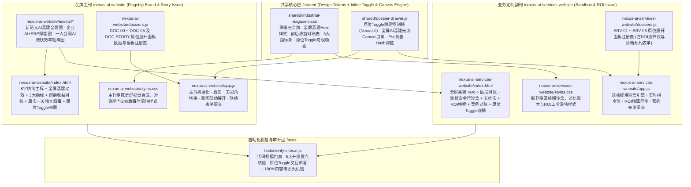

# 依然智枢 (YIRAN NEXUS) 官网 V2 升级 · 开发任务包（WPs）与质量要求文档

> **【致 Coding 执行方的总纲说明】**
> 1. 本文档为 [UPGRADE-PLAN-V2.md](file:///Users/mon3xey/projects/company/UPGRADE-PLAN-V2.md) 的工程级分发执行契约。请严格依据本文档定义的 **WP1 → WP2 → WP3 → WP4** 任务包顺序开发。
> 2. **五大核心升级硬指标**：
>    - **大标题极致精简**：主刊首屏 H1 锁定为 8 字主标 **`让智能，真正成为生产力。`**（副刊锁定为 **`让智能，真正落地每一笔订单。`**），对标参考案例的极简宏大排版节奏。
>    - **全屏恢弘 AI 基建视觉**：废除局促的局部小图框，首屏采用 **全屏大型数实交融 AI 基建场景图 + 全屏 Canvas 微动光流与算力脉冲动画背景**，各核心业务区配备契合「AI赋能、AI一人公司、AI效率、AI赚钱」的新纪元高质量配图。
>    - **核心重点直观对账**：主展区采用 **「业务场景前/后直观收益对账（Before 传统痛点 vs After 智枢收益）」+ 3 项关键产出指标（`秒级排产`、`24h自动成单`、`旧系统零推倒`）**，彻底去除主干晦涩技术黑话。
>    - **独立补充叙事**：在核心对账单下方独立设置 **「实业老板老张与超级个体小李的真实一天」** 24 小时前后对比时间轴作为补充叙事。
>    - **原位 Toggle 隐现渐进披露**：**全面废除右侧弹窗抽屉与背景滚动锁死遮罩**，所有 L2/L3 深度内容（技术规格、完整 24h 故事、纪元详情、ROI 滑块终端、预约表单）一律改为 **原位 Toggle 隐现面板（Inline Toggle Show/Hide）**，点击 `[+ 展开...]` 在当前区块下方平滑展开，再次点击 `[- 收起...]` 或按 `Esc` 原位折叠。
> 3. **内容 100% 零丢失红线**：现网已有的 10 家实业/院所客户名录、林经理电话邮箱、ICP 备案号、三大信仰、两大物种、五个纪元、定制五步法、4 大案例数据、沙盒演示与 ROI 公式必须 100% 保留在主干或原位 Toggle 面板中。

---

## 一、 目标代码架构与模块边界设计

采用 **「1 个共享核心层 (`shared/`) + 2 个独立站点应用层 (`nexus-ai-website/` 与 `nexus-ai-services-website/`) + 1 套端到端自动化机检层 (`tests/`)」** 架构，严格遵守高内聚、低耦合与单文件行数红线：



### 模块规模预算与职责清单（硬性门禁：单文件 `< 1000` 行）

| 文件路径 | 所属工作包 | 单一职责说明 | 目标行数 | 硬性上限 |
| :--- | :---: | :--- | :---: | :---: |
| `shared/industrial-magazine.css` | WP1 | 全局色彩/字体令牌、全屏 Hero 背景层、3 项关键指标条、前后收益对账表、24h 时间轴、原位 `.toggle-panel` 折叠过渡 | ~380 行 | `< 500` 行 |
| `shared/dossier-drawer.js` | WP1 | `window.NexusUI` 原位 Toggle 隐现引擎、全屏 AI 基建光流粒子 Canvas 动画、滚动揭示、复制与防 XSS 工具 | ~320 行 | `< 500` 行 |
| `nexus-ai-website/index.html` | WP2 | 主刊 L1 极简主干 DOM（8字大标题、全屏基建图与Canvas、3项指标、前后收益对账、真实一天补充叙事、纪元与合作）及原位 `.toggle-panel` 挂载点 | ~390 行 | `< 500` 行 |
| `nexus-ai-website/styles.css` | WP2 | 主刊首屏大图融合遮罩、双核配图卡片、真实一天双视角 Tab 与时间轴样式 | ~180 行 | `< 400` 行 |
| `nexus-ai-website/dossiers.js` | WP2 | 主刊 9 个原位隐现面板定义（`doc-overview`, `doc-manifesto`, `doc-pillar-erp`, `doc-pillar-opc`, `doc-story`, `doc-chronicle`, `doc-clients`, `doc-alliance`, `doc-contact`） | ~340 行 | `< 500` 行 |
| `nexus-ai-website/app.js` | WP2 | 主刊面板注册、真实一天视角切换（`switchStoryRole('erp'|'solo')`）、`selectIntent` 联动展开 `doc-contact`、表单提交 | ~160 行 | `< 350` 行 |
| `nexus-ai-services-website/index.html` | WP3 | 副刊 L1 主干 DOM（全屏基建首屏、3项关键指标、双核终端沙盒、五步法、ROI 横幅、4大案例）及原位 `.toggle-panel` 挂载点 | ~430 行 | `< 600` 行 |
| `nexus-ai-services-website/styles.css` | WP3 | 副刊黑曜石命令行终端沙盒、工业滑块与内联展开区样式 | ~220 行 | `< 450` 行 |
| `nexus-ai-services-website/dossiers.js` | WP3 | 副刊 7 个原位隐现面板定义（`srv-bottleneck`, `srv-erp-spec`, `srv-solo-spec`, `srv-process`, `srv-roi`, `srv-cases`, `srv-consult`） | ~350 行 | `< 600` 行 |
| `nexus-ai-services-website/app.js` | WP3 | 副刊双核沙盒切换与场景演示、ROI 3 滑块实时测算与主干同步、诊断预约表单转义提交 | ~360 行 | `< 600` 行 |
| `tests/verify-sites.mjs` | WP4 | 全量静态与运行时自动化机检脚本（行数门禁、视觉与配图核验、原位 Toggle 状态机、100% 内容保留、XSS 防护） | ~450 行 | — |

---

## 二、 核心跨模块接口契约（Interface Contracts）

为保证主刊（WP2）、副刊（WP3）与测试套件（WP4）平滑衔接，`shared/dossier-drawer.js` 暴露的 `window.NexusUI` 必须严格实现以下原位 Toggle 隐现契约（同时保留原方法名向后兼容）：

### 2.1 `window.NexusUI` 接口签名
```javascript
window.NexusUI = {
  /**
   * 注册当前页面的原位隐现面板字典，并在页面对应的 [data-toggle-panel="<id>"] 容器中完成初始化
   * @param {Record<string, {
   *   code: string,        // 面板编号，如 "DOC-02A // ERP ARCHITECTURE"
   *   category: string,    // 分类铭牌，如 "企业级 AI+ERP 技术规格"
   *   title: string,       // 面板主标题
   *   subtitle?: string,   // 副标题
   *   render: () => string,// 返回面板内部 HTML 字符串
   *   onMount?: (panelEl: HTMLElement) => void // 面板首次渲染挂载后的回调
   * }>} registry
   * @param {string[]} orderedIds
   */
  registerDossiers(registry, orderedIds),

  /**
   * 切换指定 ID 的原位隐现面板（若当前收起则展开，若已展开则收起）
   * @param {string} id - 面板 ID（如 'doc-pillar-erp', 'doc-story', 'srv-roi'）
   * @param {HTMLElement | null} [triggerEl] - 触发按钮
   * @returns {boolean} 切换后的展开状态（true=已展开, false=已收起）
   */
  toggleDossier(id, triggerEl),

  /**
   * 显式展开指定 ID 的原位隐现面板（幂等）
   * 更新面板 aria-hidden="false"、移除 hidden 属性、添加 .is-open 类；
   * 同步更新所有关联触发按钮 [data-toggle="<id>"] / [data-dossier="<id>"] 的 aria-expanded="true" 与文案前缀（+ 改为 -）
   */
  openDossier(id, triggerEl),

  /**
   * 显式收起指定 ID 的原位面板（若不传 id 则收起当前最后打开的面板），并归还焦点至触发按钮
   * @param {string} [id]
   */
  closeDossier(id),

  /**
   * 在有序面板间切换（收起当前面板并展开上/下一个面板）
   * @param {number} delta - -1 或 +1
   */
  stepDossier(delta),

  /**
   * 初始化首屏全屏 AI 基建微动光流与智能算力节点脉冲 Canvas 背景
   * @param {string} selector - 默认为 '.hero-field'
   */
  initHeroCanvas(selector),

  /**
   * HTML 转义工具函数（防 XSS）
   */
  escapeHtml(str),

  /**
   * 剪贴板复制并回显状态
   */
  copyText(text, btn)
};
```

### 2.2 原位 Toggle 声明式 DOM 契约
1. **触发器（Trigger）**：页面上任何带有 `data-toggle="<id>"` 或 `data-dossier="<id>"` 的按钮/行，点击时自动调用 `NexusUI.toggleDossier(id, trigger)`，切换展开与收起：
   ```html
   <button type="button" class="btn-toggle" data-toggle="doc-pillar-erp" data-dossier="doc-pillar-erp" aria-expanded="false" aria-controls="panel-doc-pillar-erp">
     <span class="toggle-icon" aria-hidden="true">+</span>
     <span class="toggle-label">展开 ERP 技术规格与无损升级方案 // DOC-02A</span>
   </button>
   ```
2. **原位隐现面板容器（Inline Panel Container）**：紧随对应业务模块下方放置原位面板挂载点，默认带有 `hidden` 与 `aria-hidden="true"`，**不锁死 `document.body.style.overflow`**，不遮挡上下文：
   ```html
   <div class="toggle-panel" id="panel-doc-pillar-erp" data-toggle-panel="doc-pillar-erp" role="region" aria-hidden="true" hidden></div>
   ```

---

## 三、 开发任务包（Work Packages）详细规范

### WP1：新纪元视觉配图生成、共享样式底座与原位 Toggle 引擎

- **涉及文件**：
  1. `nexus-ai-website/assets/hero-ai-infrastructure.jpg`（新生成）
  2. `nexus-ai-website/assets/engine-enterprise-erp.jpg`（新生成）
  3. `nexus-ai-website/assets/engine-solopreneur-matrix.jpg`（新生成）
  4. `shared/industrial-magazine.css`
  5. `shared/dossier-drawer.js`
- **具体开发要求**：
  1. **高质量主题配图生成（3 张核心大图）**：
     - `hero-ai-infrastructure.jpg`：**数实交融 AI 巨型基建全景**——深邃黑曜石夜空与恢弘的新纪元智能算力环、精密重工业母机、跨洋经纬流光交汇，采用冷钢蓝（`#9fd8ff`）与古铜金（`#b08c5c`）电影级光影，具备极强全屏视觉冲击力。
     - `engine-enterprise-erp.jpg`：**AI 赋能智慧工厂与智能排产中枢**——现代化高精度数控产线与悬浮的 золотой/古铜色智能排产数据流、BOM 拓扑网络深度耦合，直观体现工业降本增效。
     - `engine-solopreneur-matrix.jpg`：**AI 一人公司超级个体与全球创收矩阵**——极简深色全景指挥桌前，环绕 7 大自主运转的智能体全息星环、24h 跨国订单流与金色收益增长曲线，体现“一人活成一支精英团队、全天候自动赚钱”。
  2. **`shared/industrial-magazine.css` 升级**：
     - 全屏沉浸式 Hero 布局（`.hero-fullbleed`）：支持底层高清场景大图 `.hero-bg-img` + 中层 `.hero-field` 动态光流 Canvas + 顶层暗角渐变遮罩，衬托左/中极具张力的 8 字超大衬线标题（`clamp(2.8rem, 6.2vw, 5.4rem)`，参考 `myhomepage` 排版）。
     - **3 项关键产出指标条（`.key-metrics-strip`）**：3 列高对比度指标卡，突出大号衬线数字（`5s 秒级排产`、`7×24h 自动成单`、`0中断 旧系统零推倒`）。
     - **业务场景前/后直观收益对账组件（`.benefit-ledger`）**：左列「Before · 传统业务痛点」（暗灰弱化标示痛点）vs 右列「After · 智枢 AI 直观收益」（暖金/冷钢蓝高亮核心产出指标），带直观对比视觉分隔。
     - **独立补充叙事「真实一天」时间轴组件（`.day-story-box` & `.day-timeline`）**：支持「实业老板老张」与「超级个体小李」双视角 Tab 切换，单行呈現时间节点、`传统耗时痛点 ➔ AI 接管收益`。
     - **原位 Toggle 隐现面板样式（`.toggle-panel`）**：废除 `position: fixed` 右侧抽屉与遮罩，改为内联块级风琴容器，带顶部工业铭牌栏（编号、标题、`[收起面板 ×]`）、中部结构化内容区、底部 `[↑ 收起详情]` 快捷栏，展开/收起具备平滑过渡。
  3. **`shared/dossier-drawer.js` 升级**：
     - 实现原位 Toggle 隐现状态机（`toggleDossier`、`openDossier`、`closeDossier`），点击触发器时原地展开/折叠对应面板，动态切换按钮上的 `+` / `-` 指示符与 `aria-expanded` 属性。
     - 实现 `initHeroCanvas('.hero-field')`：在首屏 Canvas 上绘制流畅的新纪元智能基建日冕光弧、算力脉冲节点与金色/冷钢蓝微粒流（鼠标移动时产生微弱引力偏转，`prefers-reduced-motion: reduce` 时静态绘制首帧）。

---

### WP2：品牌主刊（`nexus-ai-website`）极简宏大化与直观对账重构

- **涉及文件**：
  1. `nexus-ai-website/index.html`
  2. `nexus-ai-website/styles.css`
  3. `nexus-ai-website/dossiers.js`
  4. `nexus-ai-website/app.js`
  5. `nexus-ai-website/README.md`
- **具体开发要求**：
  1. **00 首屏 (`#hero`) —— 极简大标题 + 全屏 AI 基建背景**：
     - 背景层：`` + `<canvas class="hero-field" aria-hidden="true"></canvas>`。
     - 标题层（严格精简为 8 字主标）：
       ```html
       <p class="eyebrow">EST. 2015 · 国家级科技型中小企业 · 10年实业软件沉淀</p>
       <h1 class="hero-title">
         <span class="line">让智能，</span>
         <span class="line">真正成为<em>生产力</em>。</span>
       </h1>
       <p class="hero-lead">深耕实业十载。我们打造企业级 AI+ERP 智能中枢与一人公司效能军团，让大模型在车间与商机中创造真金白银。</p>
       ```
     - 行动按钮：`[进入业务沙盒与定制 →]` + `[+ 展开企业总览与资质 // DOC-00]`（原位展开 `#panel-doc-overview`）。
     - 首屏底部 **3 项关键产出指标条（`.key-metrics-strip`）**：
       - **秒级排产 (`5s`)**：复杂工序动态重算 · 设备稼动率提升 **+28%**
       - **24h 自动成单 (`7×24h`)**：跨时区全语种销冠响应 · 夜间询盘转化 **+300%**
       - **旧系统零推倒 (`0中断`)**：无损挂接现有 ERP 与机床 · **100%** 保护历史数据
  2. **01 企业愿景与文化 (`#manifesto`) —— 突出底蕴，直白表达**：
     - 主标：**「不做浮夸的聊天玩具，只造能下车间、能赚钱的智能系统。」**
     - 三大核心文化底色卡片（直观大白话）：
       - `01 科技平权`：十年工业软件功底，把千亿大模型变成中小企业用得起的生产力水电煤。
       - `02 拒绝套壳与推倒重来`：业务长什么样，AI 就怎么配；旧系统零推倒无损升级。
       - `03 结果与收益导向`：不按代码行数自嗨，只按帮您省下多少工时、多赚多少订单说话。
     - 底部配 `[+ 展开使命宣言与工程信仰深度档案 // DOC-01]`（原位 Toggle 展开 `#panel-doc-manifesto`，内含完整三大信仰原文与 `POLE A / POLE B` 认知桥接架构）。
  3. **02 核心服务主展区 (`#pillars`) ——「业务场景前/后直观收益对账」**：
     - **核心产品一：企业级 AI+ERP 智能中枢**（配图 `assets/engine-enterprise-erp.jpg`）
       - 前/后直观收益对账表（Before vs After）：
         - `车间排产`：人工拿 Excel 吵一上午、插单全乱 ➔ **5 秒全局智能排产，设备稼动率 +28%**
         - `审单核价`：复杂图纸人工翻账 3 天、漏算亏本 ➔ **30 秒解析 CAD/单据精准报价，0 漏算**
         - `库存与业财`：百万呆滞料积压、月底才算清账 ➔ **动态库存预警与业财一体，资金周转 +30%**
         - `系统改造`：传统换 ERP 停工半年、全员抵触 ➔ **旧系统零推倒无损接入，1对1 包教包会**
       - 触发器：`[+ 展开 ERP 技术架构与八大模块规格 // DOC-02A]`（原位 Toggle 展开 `#panel-doc-pillar-erp`）。
     - **核心产品二：一人公司 (OPC) AI 效能军团**（配图 `assets/engine-solopreneur-matrix.jpg`）
       - 前/后直观收益对账表（Before vs After）：
         - `跨国接单`：半夜海外询盘熟睡漏回、大单流失 ➔ **24h 多语种销冠客服，睡梦中自动谈判收定金**
         - `获客营销`：写文案剪视频耗尽精力、招人昂贵 ➔ **全网获客内容矩阵自动分发，1 人顶 10 人团队**
         - `跟单履约`：报关、物流、催款一人连轴转 ➔ **全自动跟单 RPA 闭环，喝茶时全球业务自转**
       - 触发器：`[+ 展开一人公司 7 大数字员工配置清单 // DOC-02B]`（原位 Toggle 展开 `#panel-doc-pillar-opc`）。
  4. **02.5 独立补充叙事 (`#day-story`) ——「实业老板与超级个体真实一天」**：
     - 作为独立补充叙事区块，顶部提供视角切换按钮：`[视角 A · 制造厂老板老张的 24h]` / `[视角 B · 出海主理人小李的 24h]`。
     - 主干展示 3 个黄金时间节点的「接入前 vs 智枢 AI 接管后」直观时间轴；底部配 `[+ 展开老张与小李 24 小时全流程对比实录 // DOC-STORY]`（原位 Toggle 展开 `#panel-doc-story`）。
  5. **03 演进纪元与 10 家实业背书 (`#chronicle`)**、**04 生态合作 (`#alliance`)**、**05 建立连接 (`#contact`)**：
     - 保持清爽发丝线列表与 10 家实业/院所铭牌网格，所有 `[+ 展开...]` 按钮均在各自章节下方原位 Toggle 展开对应面板（`#panel-doc-chronicle`、`#panel-doc-clients`、`#panel-doc-alliance`、`#panel-doc-contact`）。

---

### WP3：业务定制副刊（`nexus-ai-services-website`）全屏视觉同步与原位 Toggle 化

- **涉及文件**：
  1. `nexus-ai-services-website/index.html`
  2. `nexus-ai-services-website/styles.css`
  3. `nexus-ai-services-website/dossiers.js`
  4. `nexus-ai-services-website/app.js`
- **具体开发要求**：
  1. **00 首屏 (`#hero`) 升级**：
     - 同步引入全屏 AI 基建背景图（`../nexus-ai-website/assets/hero-ai-infrastructure.jpg`）与 `.hero-field` 动态光流 Canvas，右侧保留纯 SVG `Nexus-Bridge™` 三层架构拓扑图与 `#live-log-text` 实时指令流。
     - 大标题精简为：**`让智能，真正落地每一笔订单。`**
     - 首屏下方同步呈現 **3 项关键产出指标（秒级排产 `5s`、24h 自动成单 `7×24h`、旧系统零推倒 `0中断`）**。
  2. **全站抽屉改为原位 Toggle 隐现面板**：
     - `#panel-srv-bottleneck`：在 `01 破局` 下方原位展开「三大痛点深度剖析与新旧 ERP 三维对比表」。
     - `#panel-srv-erp-spec` & `#panel-srv-solo-spec`：在 `02 双核终端沙盒` 下方原位展开「企业 AI+ERP / 一人公司 AI 套件完整模块规格与私有化安全架构」。
     - `#panel-srv-process`：在 `03 定制五步法` 下方原位展开「五步法驻场实施细则与包教包会培养 1 名管理员承诺」。
     - `#panel-srv-roi`：在 `04 ROI 价值测算` 下方原位展开「3 滑块交互式 ROI 精算终端」（支持实时拖动滑块计算并同步更新主干横幅读数）。
     - `#panel-srv-cases`：在 `05 实业实录` 下方原位展开「4 大标杆案例完整痛点/方案/指标复盘与 10 家实业背书」。
     - `#panel-srv-consult`：在 `06 预约诊断` 下方原位展开「1对1 免费上门/远程诊断预约表单」。

---

### WP4：自动化机检套件升级（`tests/verify-sites.mjs`）与独立交叉审计

- **涉及文件**：`tests/verify-sites.mjs`
- **具体开发要求**：
  - 扩充并运行自动化验收脚本，覆盖以下 6 大测试集（全部断言必须 100% PASS，退出码为 0）：
    1. **代码规模与整洁度**：全部 10 个核心源码文件存在且单文件 `< 1000` 行（符合各 WP 行数门禁），无 `TODO/FIXME` 占位，JS 语法编译通过，HTML 标签严格闭合。
    2. **新纪元视觉配图与反模式清零**：验证 3 张新生成配图（`hero-ai-infrastructure.jpg`、`engine-enterprise-erp.jpg`、`engine-solopreneur-matrix.jpg`）真实存在且体积有效（`> 30KB`）；验证全屏 `.hero-field` Canvas 存在；无外部重框架与旧版赛博霓虹反模式。
    3. **五大改进要点专项核验**：
       - 断言主刊 8 字精简大标题 `让智能，真正成为生产力。` 与副刊精简大标题存在；
       - 断言 **3 项关键产出指标**（`秒级排产`、`24h 自动成单`、`旧系统零推倒`）在主干清晰呈现；
       - 断言 **业务场景前/后直观收益对账**（`.benefit-ledger`）在主刊主展区存在；
       - 断言 **独立补充叙事「真实一天」**（`#day-story`、老张与小李 24h 时间轴及 `switchStoryRole` 切换函数）正常工作；
       - 断言 **原位 Toggle 隐现机制**（`.toggle-panel`）已取代旧弹窗抽屉，展开时**不锁死** `body.style.overflow`。
    4. **内容 100% 零丢失断言**：10 家客户、联系方式、ICP 备案号、三大信仰、两大物种、五个纪元、五步法、4 大案例、ROI 与沙盒数据零丢失。
    5. **主刊运行时 DOM 与原位 Toggle 交互测试**：验证全部 9 个面板（含 `doc-story`）均可通过 `toggleDossier` / `openDossier` 原位展开（`hidden=false`, `aria-hidden="false"`, 触发器 `aria-expanded="true"`）与收起（`closeDossier` / `Esc` 键），验证 `switchStoryRole('solo'|'erp')`、表单提交与 XSS 转义。
    6. **副刊运行时 DOM 与原位 Toggle 交互测试**：验证全部 7 个面板原位展开与收起、双核沙盒 6 个场景运行、ROI 测算器计算精度与表单提交。

---

## 四、 质量红线与验收标准（Quality Gates & Acceptance Criteria）

1. **架构原则红线**：严格遵循“低耦合、高内聚”，共享机制收敛于 `shared/`，视图、样式、面板数据与业务控制分离，单文件行数严格低于门禁上限。
2. **零容忍交付准则**：
   - 严禁任何形式的偷工减料、虚假占位（`TODO`、`pass`、`...`）或删减原有业务数据。
   - 交付时必须附上 `node tests/verify-sites.mjs` 真实机检输出（要求全部检查项 100% PASS，退出码为 0）。
3. **MiniMax-M3 交叉审计门禁**：
   - 每完成关键阶段及全站收尾后，必须拉起 `MiniMax-M3` 进行独立交叉代码审计，重点核查模块边界、复杂度、异常边界、幂等性与测试覆盖率，发现问题立即闭环修复。
