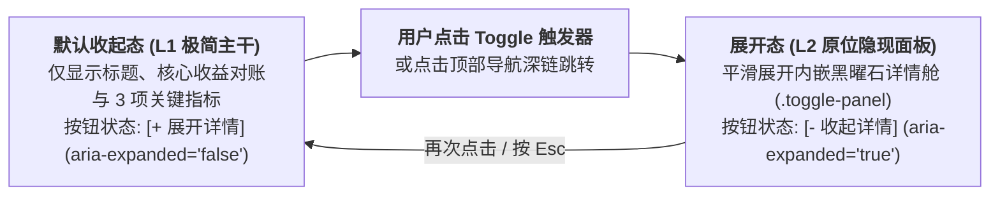

# 依然智枢 (YIRAN NEXUS) 官网全站升级技术实施方案 (V2 最终确认版)

> **定位升维**：新纪元宏大叙事 × 工业生产力实战  
> **视觉基准**：大型视觉冲击力 AI 基建全屏场景 + 微动光流动态背景（对标极简宏大气场）  
> **核心表达**：大标题 8 字精炼 · 「业务场景前/后直观收益对账 + 3 项关键指标」为主干 · 「真实一天故事线」为独立补充叙事 · **原位 Toggle 隐现渐进披露**  
> **双刊架构**：品牌主刊（宏大门面、直观收益对账与真实故事补充） + 业务副刊（落地沙盒与 ROI 测算工具箱）

---

## 一、 核心升级决策决议矩阵 (Grill-Me 确立共识)

| 升级维度 | 现网痛点诊断 | V2 升级敲定方案 | 客户心智与体验收益 |
| :--- | :--- | :--- | :--- |
| **首屏大标题** | 4 行长句 24 字，繁复累赘 | **「让智能，真正成为生产力。」**（8 字核弹级主标，对标极简经典排版） | 1 秒看懂企业核心价值，气场宏大克制 |
| **首屏视觉背景** | SVG 工业星盘线框 + 普通车床机床灰度照片 | **大型视觉冲击力 AI 基建全屏场景图 + 全屏微动光流动画背景**（数实交融 AI 巨型基建全景：智能算力矩阵与实体机械/全球流光交汇） | 极强视觉震撼力，新纪元宏大气场与硬核工业赋能感拉满 |
| **核心服务主展区** | 抽象的 POLE A/B、BOM 认知桥接等晦涩黑话 | **「业务场景前/后直观收益对账」+ 3 项关键产出指标（秒级排产、24h 自动成单、旧系统零推倒）** | 硬核数据与直观收益一眼看穿，直击老板决策爽点 |
| **独立补充叙事** | 缺少具象化代入感 | **「实业老板与超级个体真实一天」故事化对比时间轴**作为独立补充叙事，支持 Toggle 展开完整 24h 对比 | 主干利落看收益，补充叙事看全天真实场景还原 |
| **渐进披露机制** | 右侧弹窗抽屉打断阅读视线、割裂上下文 | **原位 Toggle 隐现模式 (Inline Toggle Show/Hide)**：默认极简收起，点击 `[+ 展开详情]` 原地平滑展开/收起，视线无需跳跃 | 上下文连贯自然，操作直觉轻量，移动端与桌面端体验极佳 |
| **全站协同架构** | 两站视觉风格与表达有差异 | **保持「主刊（品牌门面）+ 副刊（实战工具）」协同**，统一全屏视觉与 Toggle 交互范式 | 品牌形象立得住，实务转化促得成 |

---

## 二、 文本与话语体系重构详案

### 1. 品牌主刊 (`nexus-ai-website`) 首屏文案
- **大标题 (H1)**：
  ```html
  <h1 class="hero-title">
    <span class="line">让智能，</span>
    <span class="line">真正成为<em>生产力</em>。</span>
  </h1>
  ```
- **副标题 (Subhead)**：  
  深耕实业十载。我们打造企业级 AI+ERP 智能中枢与一人公司效能军团，让前沿大模型在车间与商机中创造真金白银。
- **状态铭牌 (Status)**：  
  `EST. 2015 · 国家级科技型中小企业 · 打通落地最后一公里`
- **主行动按钮 (CTA)**：  
  - `[进入业务沙盒与定制 →]`（指向副刊）  
  - `[+ 展开企业总览与资质]`（原位 Toggle 展开首屏下方企业核心档案与软著资质面板）

---

### 2. 核心服务主展区：「业务场景前/后直观收益对账」+ 3 项关键产出指标

主展区以极简、克制的双栏工业对账单形式直接呈现两大核心产品线与 **3 项关键产出指标**，技术细节采用 **原位 Toggle 隐现**：

#### 2.1 三项全站核心产出指标 (Headline Metrics)
1. **秒级排产 (`5s`)**：复杂多工序动态重算，车间设备稼动率提升 **+28%**
2. **24h 自动成单 (`7×24h`)**：跨时区全语种销冠响应，夜间询盘转化率提升 **+300%**
3. **旧系统零推倒 (`0 中断`)**：无损挂接现有 ERP / 数据库 / 机床，**100%** 保护历史数据资产

#### 2.2 双核服务前/后直观收益对账表 (Before vs. After Ledger + Inline Toggle)

| 核心产品线 | 传统业务模式痛点 (Before) | 智枢 AI 赋能收益 (After) | 原位渐进披露触发 (Toggle) |
| :--- | :--- | :--- | :--- |
| **01 · 企业级 AI+ERP 智能中枢**<br>*(面向制造工厂 / 工贸一体 / 供应链)* | • 人工排产吵一上午，急单插单全厂乱套<br>• 复杂图纸人工核价 3 天，漏算损耗亏本<br>• 呆滞库存积压百万，月底财务才算清账 | • **5 秒智能排产**，工位看板实时自动调度<br>• **30 秒图纸审单比价**，精准锁死毛利底线<br>• **动态库存预警**，资金周转率跃升 **30%+** | `[+ 展开 ERP 技术架构与无损升级方案]`<br>*(点击在当前卡片下方平滑展开详细模块规格)* |
| **02 · 一人公司 AI 效能军团**<br>*(面向出海贸易 / 电商卖家 / 超级个体)* | • 半夜跨国询盘熟睡漏回，大单被同行截胡<br>• 写文案做物料耗尽精力，招人成本高昂<br>• 报关、物流、跟单一人扛，全年无休连轴转 | • **24h 智能销冠客服**，熟睡中自主谈判收定金<br>• **全网获客内容矩阵**，1 人具备 10 人团队产能<br>• **全自动跟单履约**，喝茶时全球业务自动流转 | `[+ 展开一人公司 7 大智能体配置清单]`<br>*(点击在当前卡片下方平滑展开 Agent 协同明细)* |

---

### 3. 独立补充叙事：「实业老板与超级个体真实一天」故事化时间轴

作为核心收益对账下方的**独立补充叙事块**，默认展示精炼概要，支持 **Toggle 隐现切换/展开** 完整 24 小时时间轴对比：

- **视角 A：制造厂老板老张的 24 小时**（点击 `[+ 展开老张的 24h 完整实录]` 显隐）
  - `08:30 晨会排产`：告别 Excel 扯皮 ➔ AI 5 秒生成全局最优工序排程。
  - `14:00 图纸核价`：告别 3 天人工翻账 ➔ AI 30 秒解析 CAD 图纸并核算成本。
  - `20:00 库存盘点`：告别百万死库存 ➔ AI 实时预警呆滞料并联动业财日报。
- **视角 B：出海主理人小李的 24 小时**（点击 `[+ 展开小李的 24h 完整实录]` 显隐）
  - `02:00 跨国询盘`：告别时差漏单 ➔ AI 销冠多语种秒回并自动锁单收款。
  - `10:00 全网获客`：告别熬夜写稿 ➔ AI 自动抓取热点生成多平台获客图文。
  - `16:00 履约跟单`：告别繁琐核单 ➔ AI 自动核验提单、同步物流并通知买方。

---

## 三、 原位 Toggle 隐现交互机制设计 (Inline Toggle Architecture)

全面取消遮挡视线的右侧抽屉与背景锁死遮罩，改为轻量、高内聚的原位隐现机制：



1. **交互语义与无障碍**：
   - 触发按钮统一使用 `data-toggle="<panel-id>"` 与 `aria-expanded="false/true"`、`aria-controls="<panel-id>"`；
   - 展开容器 `.toggle-panel` 使用 `hidden` 属性与 CSS Grid `grid-template-rows: 0fr -> 1fr` + `opacity` 过渡，实现丝滑的原位高度展开与收起，不引发突兀跳动；
   - 支持单选手风琴组（同组展开一个自动收起另一个）或独立自由开关，按 `Esc` 键可一键收起当前焦点所在的展开面板。
2. **全站各章节 Toggle 隐现面板映射**：
   - `toggle-overview`：首屏下方展开「企业总览、国家级科技型中小企业资质与软著清单」
   - `toggle-manifesto`：愿景下方展开「三大工程信仰与硅基-碳基融合深度论述」
   - `toggle-erp`：企业 AI+ERP 对账单下方展开「8 大核心功能模块、旧系统零推倒架构与私有化方案」
   - `toggle-opc`：一人公司对账单下方展开「7 大数字员工岗位职责与全自动创收链路」
   - `toggle-story`：真实一天补充叙事下方展开「老张与小李 24h 前后完整对比时间轴」
   - `toggle-chronicle`：纪元发丝线列表展开「2015—2027 五个纪元完整技术演进档案与 10 家实业客户名录」
   - `toggle-contact`：底部合作区原位展开「加密联络与 1对1 业务诊断预约表单」

---

## 四、 全屏视觉与高质量配图实施规划

1. **首屏大型视觉冲击力基建场景图 (`hero-ai-infrastructure.jpg`)**：
   - 深邃宏大的新纪元数实交融 AI 巨型基建全景：精密工业母机、全球经纬流光与发光古铜金/冷钢蓝智能算力矩阵交汇，搭配全屏 Canvas 微动光流与节点脉冲动画。
2. **企业 AI+ERP 赋能配图 (`engine-enterprise-erp.jpg`)**：
   - 高精度现代智能车间与算力中枢交融意象，内嵌于企业 ERP 展区与展开面板。
3. **一人公司 AI 赚钱与效率配图 (`engine-solopreneur-matrix.jpg`)**：
   - 超级个体极简全息指挥台与全球自动化贸易星环意象，内嵌于一人公司展区与展开面板。

---

## 五、 代码质量与交付红线控制

1. **单文件规模控制**：所有业务源码单文件严格控制在 500~600 行以内，高内聚低耦合。
2. **零容忍交付标准**：严禁 TODO、pass、占位实现；更新并运行 `node tests/verify-sites.mjs` 验证所有 Toggle 隐现交互、表单转义与内容完整性 100% 绿灯通过；执行 MiniMax-M3 交叉代码审计闭环后交付。
