# 依然智枢 (YIRAN NEXUS) 官网重构与信息层级优化方案
> **风格定位**：AI 科技工业杂志风格（AI Tech Industrial Editorial Magazine）  
> **核心原则**：内容 100% 完整保留 · 主干极致克制留白（L1） · 细节与重工具收进右侧工业档案抽屉（L2/L3） · 双刊统一黑曜石视觉语言

---

## 一、 三大参考案例核心设计基因提炼

通过对三个标杆案例的代码级拆解，提炼出本次「AI 科技工业杂志风格」的三大支柱基因：

| 维度 | 案例 A：`myhomepage/docs/index.html`（林远） | 案例 B：`pweb/landing.html`（林垚） | 案例 C：`untitled folder/index.html`（陈默） | 依然智枢（YIRAN NEXUS）融合落地方案 |
| :--- | :--- | :--- | :--- | :--- |
| **色彩与底材** | 深碳黑 `#0a0b0d` + 暖象牙白 `#ece8e1` + 冰钢蓝 `#9fd8ff` | 暖米档案纸 `#f3ede2` + 深墨黑反白块 `#0e1018` + 工业古铜 `#8b6f47` | 黑曜石 `#0a0c0f` + 暖骨白 `#eae6dc` + 暗金羊皮纸 `#e8e0cc` | **全站统一黑曜石暗调刊物基底**（`#0a0c0f` 底 + `#eae6dc` 字 + 古铜 `#b08c5c` 与冷钢蓝 `#9fd8ff` 双点缀） |
| **字体排印系统** | `Noto Serif SC` + `Instrument Serif`（斜体副标）+ `Inter Tight` | `DM Serif Display` / `Songti SC` + `Outfit` + `JetBrains Mono` | `Noto Serif SC`（高字重）+ `Bodoni Moda`（拉丁衬线）+ `Archivo` + `JetBrains Mono` | **中文人文衬线主标**（`Noto Serif SC`）+ **拉丁古典刊物衬线**（`Bodoni Moda` / `Instrument Serif`）+ **紧凑无衬线正文**（`Inter Tight`）+ **等宽工业编号/终端**（`JetBrains Mono`） |
| **版式骨架与网格** | **1 : 3 左粘性章节名 + 右通栏发丝线列表**（`.section` sticky 标题 + `ul.rows` / `ol.works`） | **1 : 2 章节导语头 + 交替图文/数据账本**（`.section-head` + `.work-stats` 三联指标） | **5 : 7 非对称宣言分栏 + 双栏发丝线对账单**（`.about-grid` + `.invest-cols`） | 废除圆角毛玻璃卡片网格；全面改用 **1px 发丝线（Hairline Rules）水平/垂直分割账本** 与 **左窄右宽杂志分栏** |
| **工业杂志符号** | 垂直排版状态铭文（`writing-mode: vertical-rl`）、全宽暗调摄影过渡带（`.band`） | 80×80px 微动工程网格（`.hero-grid`）、命令行黑盒（`.terminal-card`）、SVG 节点拓扑图 | 四角精密准星画框（`.hero-frame`）、十字准星标记（`.mark` `+`）、SVG 星盘几何线框、底部经纬状态读数 | 首屏四角准星画框 + 十字准星 `.mark` + 经纬度/运行状态读数 + 窄幅暗调车间机床实景摄影带 + 精密 SVG 拓扑图 |
| **信息密度控制** | 每个作品/专长仅「年份 + 标题 + 1句话 + 2个标签」，零多余卡片 | 指标只列 Pre/Post 核心数字（`+28% / -62% / 8k`），深度内容收于链接 | 能力与作品全为单行发丝线条目，右侧仅放 2 个大号衬线数字指标 | **主干（L1）严格限制为「标题 + 单句定性 + 2~3个核心数字 + `[+ 调取档案]`」**，长文与工具全部抽屉化 |

---

## 二、 现网诊断与核心痛点（Why Re-plan）

当前工作区包含品牌主刊 [`nexus-ai-website/index.html`](file:///Users/mon3xey/projects/company/nexus-ai-website/index.html) 与业务定制副刊 [`nexus-ai-services-website/index.html`](file:///Users/mon3xey/projects/company/nexus-ai-services-website/index.html)，存在四大结构性问题：

1. **视觉语言割裂且偏离「工业杂志」质感**：
   - 主刊使用高饱和赛博青紫渐变（`#00F0FF` / `#7000FF`）、全屏 Three.js 悬浮粒子与双层激光自定义光标；副刊使用传统 SaaS 蓝绿高饱和渐变按钮、FontAwesome 通用图标与发光圆角卡片。两页像不同公司的模板拼凑，缺乏严肃工业科技的厚重感与杂志编辑感。
2. **信息层级扁平，全量细节一次性平铺**：
   - 主刊把 3 大信仰长文、双物种详细描述、5 个演进纪元完整卡片、10 家客户圆角块、3 大合作卡片与 5 字段表单全部平铺展开；
   - 副刊更是将 3 层架构卡、3 个痛点红绿卡、8 个功能模块卡、2 个交互沙盒、3 列对比表、5 步流程卡、3 滑块 ROI 计算器、4 个长文案例卡、10 个客户徽章和预约表单堆砌在近千行单页中，造成极高的认知负荷。
3. **缺少「渐进式披露（Progressive Disclosure）」机制**：
   - 访客无法在 10 秒内快速扫读全站脉络；真正想看细节（如某案例原痛点/方案、五步法交付物、ROI 测算、投资备忘录）时，又混杂在密集的视觉噪音中。

---

## 三、 AI 科技工业杂志设计系统规范（Design System Tokens）

主刊与副刊共享同一套 CSS 变量与底层排版原语（同步更新至 [`design-system/yiran-nexus/MASTER.md`](file:///Users/mon3xey/projects/company/design-system/yiran-nexus/MASTER.md)）：

### 3.1 色彩令牌（Color Tokens）
```css
:root {
  /* 基底：黑曜石深底与次级暗舱 */
  --bg: #0a0c0f;
  --bg-2: #0e1116;
  --bg-drawer: #11151c;

  /* 墨色：暖骨白主字与三级灰度层次 */
  --ink: #eae6dc;
  --ink-2: #b6b0a1;
  --ink-3: #8a8473;

  /* 工业点缀：古铜黄铜（编号/准星/历史沉淀）与冷钢蓝（AI/终端状态/焦点） */
  --bronze: #b08c5c;
  --bronze-dim: rgba(176, 140, 92, 0.38);
  --accent: #e8e0cc;
  --steel: #9fd8ff;
  --steel-dim: rgba(159, 216, 255, 0.28);
  --ok: #7ec699;

  /* 发丝线分割（替代圆角卡片阴影） */
  --hairline: rgba(234, 230, 220, 0.14);
  --hairline-soft: rgba(234, 230, 220, 0.07);
}
```

### 3.2 字体与排印原语（Typography Primitives）
- **中文刊物主标题 (`--serif`)**：`"Noto Serif SC", "Songti SC", "STSong", serif`（字重 500/600/700，字距 `-0.01em ~ -0.02em`）。
- **拉丁古典刊物衬线 (`.latin`)**：`"Bodoni Moda", "Instrument Serif", Georgia, serif`（用于章节英文副标、大号统计数字与斜体强调词）。
- **现代无衬线正文 (`--sans`)**：`"Inter Tight", "Archivo", "PingFang SC", "Noto Sans SC", sans-serif`（字重 300/400/500，行高 `1.75`）。
- **工业等宽技术字体 (`.mono`)**：`"JetBrains Mono", "SF Mono", ui-monospace, monospace`（字号 `11px–12.5px`，字距 `0.08em–0.18em`，全大写用于章节编号、经纬度、技术标签与终端交互）。

### 3.3 标志性工业杂志视觉组件
1. **四角精密准星画框 (`.hero-frame`)**：首屏内嵌 `1px solid var(--hairline-soft)` 边线，四角绘制 `14px × 14px` 的 `--bronze-dim` 直角准星。
2. **十字准星注册标记 (`.mark`)**：`12px × 12px` 伪元素十字细线，置于章节条目、物种名、案例标题左侧，替代廉价的彩色圆点与通用图标。
3. **微弱暖铜跟随光晕 (`.cursor-glow`)**：移除原有的 `#cursor-dot` 与 `#cursor-ring` 激光圈，恢复系统原生指针，辅以 `360px` 直径、`rgba(176, 140, 92, 0.08)` 的低存在感暖铜环境光晕。
4. **窄幅暗调真实多行业工业摄影过渡带 (`.band`)**：在核心章节之间穿插高对比度、黑曜石底色的真实数智化实录大图，覆盖先进制造（`industry-manufacturing-floor.jpg`）、现代贸易与供应链物流（`industry-logistics-supply-chain.jpg`）、医疗健康与跨行业商业决策（`industry-multi-sector-operations.jpg`），全景展现 AI+ERP 服务实体多行业场景，上下边缘与 `--bg` 平滑渐变融合。

---

## 四、 核心信息架构：三层渐进式披露（L1 主干 + L2/L3 工业档案抽屉）

遵循「**内容一字不删，但主页面绝不堆砌长文**」的原则，全站信息按三个层级重新编排：

```mermaid
flowchart LR
    subgraph L1["L1 · 杂志主干层 (Main Editorial Spine)"]
        A1["章节编号 + 中英衬线主标题"]
        A2["单句核心论断 (<= 40字)"]
        A3["2~3个大号衬线指标 / 发丝线目录行"]
        A4["副刊专属：黑曜石命令行交互沙盒"]
    end

    subgraph Trigger["触发机制 (Triggers)"]
        T1["点击发丝线行 / [+ 调取档案 DOSSIER]"]
        T2["点击 [⚙ 启动 ROI 精算终端]"]
        T3["点击 [↗ 发起加密联络 / 预约诊断]"]
    end

    subgraph L2L3["L2/L3 · 右侧工业档案抽屉 (Slide-over Dossier Drawer)"]
        D1["档案头：DOSSIER ID · 分类铭牌 · ESC关闭"]
        D2["完整叙事正文 / 原痛点与定制方案深度复盘"]
        D3["结构化规格对账表 / 传统ERP vs 智枢AI+ERP对比表"]
        D4["交互式三滑块 ROI 测算仪 / 1对1联络与诊断表单"]
    end

    L1 --> Trigger --> L2L3
```



### 右侧工业档案抽屉（`#dossier-drawer`）交互规范
- **形态与尺寸**：右侧固定滑出（`width: min(680px, 92vw)`，高度 `100dvh`），背景 `var(--bg-drawer)`，左边框 `1px solid var(--hairline)`，配半透明暗色背景遮罩（`backdrop-filter: blur(6px)`）。
- **工业档案头部栏**：顶部固定显示 `DOSSIER // 档案编号`（如 `DOC-01.B · 三大信仰与认知桥接拓扑`）、章节分类标签与 `[ESC / 关闭 ×]` 按钮。
- **底部快捷流转栏**：每个档案抽屉底部配有「上一份档案 / 下一份档案」切换器，以及直达「发起联络 / 预约诊断表单抽屉」的快捷动作按钮。
- **无障碍与键盘支持**：支持 `Esc` 键关闭、遮罩点击关闭、打开时锁定背景滚动并将焦点移入抽屉标题，支持 URL Hash（如 `#dossier=chronicle-2015`）直接深链打开对应档案。

---

## 五、 品牌主刊（`nexus-ai-website/index.html`）信息层级重构方案

> **主刊定位**：企业数字名片、思想宣言、十年演进纪元、实业背书、投资与生态合作（IR & Alliance）。  
> **重构策略**：「极致留白主干 + 右侧工业档案抽屉」，主页面不展开任何卡片长文与表单。

### 5.1 顶部导航栏（`.site-head`）
- **左侧品牌**：`依然智枢` + 古铜圆点 + `.latin` `YIRAN NEXUS` + 等宽铭牌 `EST. 2015 · 宁波依然网络`。
- **中部锚点**：`01 使命` · `02 物种` · `03 纪元` · `04 生态` · `05 连接`。
- **右侧动作**：`业务副刊：沙盒与定制 ↗`（跳转副刊）+ `[发起联络]`（直接呼出右侧联络终端抽屉）。

### 5.2 逐章节 L1 主干 vs. L2/L3 档案抽屉映射表

| 章节 | L1 页面主干展示内容（默认可见，极致克制） | 触发器文案 | L2/L3 右侧工业档案抽屉内容（默认隐藏，点击滑出） |
| :--- | :--- | :--- | :--- |
| **00. 首屏开场**<br>`#hero` | • 四角准星画框 `.hero-frame` + 右侧动态 **SVG 工业星盘/桥接几何线框图**（替代 Three.js 粒子）<br>• 顶部单行等宽徽章：`国家级科技型中小企业 · 2015年起深耕生产管理与进销存研发`<br>• 巨幅衬线主标题：`让大模型能力普惠百业，打通 AI 与实体生产的最后一公里。`<br>• 1 句精炼导语（宁波依然网络科技旗下产业智能品牌）<br>• 2 个主按钮：`进入业务沙盒与定制副刊 →`、`[+ 调取企业总览档案]`<br>• 底部经纬与四联核心指标条（`2015 创立` / `10年+ 工业软件软著` / `AI+ERP & 一人公司双核` / `29.89°N 121.55°E · OPEN`） | `[+ 企业总览档案]` | **档案 `DOC-00`**：依然智枢完整品牌背景、国家级科技型中小企业资质说明、核心软件著作权沉淀与双引擎架构概览。 |
| **01. 使命宣言**<br>`#manifesto` | • 左栏 sticky 章节标：`01 / 使命宣言 MANIFESTO`<br>• 右栏 5:7 杂志布局：左侧大号衬线金句「跨越硅基智能与碳基实业的鸿沟」；右侧极简 **POLE A (认知层) ⇄ NEXUS BRIDGE ⇄ POLE B (实体层)** 单行矢量刻度条<br>• 下方 3 条发丝线目录行（仅露编号与标题）：<br>  `+ 01 / 科技平权：AI 不应只是巨头的特权`<br>  `+ 02 / 拒绝标准品桎梏：软件迁就业务，而非业务削足适履`<br>  `+ 03 / 结果导向：打通“最后一公里”才是终局` | 点击任一信仰行或 `[+ 查阅使命全文]` | **档案 `DOC-01`**：POLE A 万亿参数大模型与 POLE B 中小企业/超级个体现场的完整对比论述 + 三大核心信仰支柱的完整段落解析。 |
| **视觉过渡带** | **窄幅全宽先进制造摄影带 `.band`**：现代化五轴联动智能车间与排产工程师实景（`industry-manufacturing-floor.jpg`），配角标 `FIG.01 // ADVANCED MANUFACTURING · SMART CNC & PRODUCTION CORE` | — | — |
| **02. 战略双翼**<br>`#pillars` | • 左栏 sticky 章节标：`02 / 核心基石 PILLARS`<br>• 右栏上下两条杂志级通栏大条目（参考林远 `.work` + 陈默 `.case`）：<br>  1. **`SPECIES 01` 企业级 AI+ERP 智能中枢**（`Autonomous ERP`）—— 一句话定义 + 右侧三联等宽指标（`自然语言即指令` · `本地私有化/混合云` · `1:1 贴合非标产线`）<br>  2. **`SPECIES 02` 一人公司 AI 数字硅基团队**（`OPC Matrix`）—— 一句话定义 + 右侧三联等宽指标（`1人 = 10+ 专业岗位` · `方法论数字克隆` · `边际成本趋零`） | `[+ 调取物种规格书]` / `[↗ 前往副刊交互沙盒]` | **档案 `DOC-02A / 02B`**：两大智能物种的完整产品哲学、解决的传统软件痛点、技术底座细节，以及直跳副刊对应沙盒的快捷入口。 |
| **03. 演进纪元与实业背书**<br>`#chronicle` | • 左栏 sticky 章节标：`03 / 演进纪元 CHRONICLE`<br>• 右栏 **5 行极简编年史账本**（参考林远 `ol.works`）：每行仅展示 `年份 (2015-22 / 2023 / 2024 / 2025-26 / 2027+)` + `阶段代号` + `单行核心里程碑标题` + `[+ 纪元详情]`<br>• 下方紧接 **实业与科研院所信赖名录（单行工业铭牌索引网格）**：仅展示 10 家客户名称与精简行业属性标签（`佳乐股份`、`凯孚新材料`、`中国—中东欧国家创新合作研究中心` 等） | 点击任一纪元行 / 点击 `[+ 查阅 10 家标杆客户交付档案]` | **档案 `DOC-03A`**：2015–2027+ 五大演进纪元的完整技术与商业复盘。<br>**档案 `DOC-03B`**：10 家制造实业、商贸供应链与国家级/市级科研院所的完整合作背景与跳转副刊案例详情通道。 |
| **04. 投资与生态**<br>`#alliance` | • 左栏 sticky 章节标：`04 / 投资与生态 ALLIANCE`<br>• 右栏采用陈默式 `.invest-cols` **三栏发丝线对账单**：<br>  1. `CAPITAL VISION / 资本价值`：万亿级存量软件重塑红利<br>  2. `CHANNEL PARTNER / 渠道共赢`：产业园区与行业商协会赋能<br>  3. `TECH ALLIANCE / 算力生态`：大模型与硬件厂商联合方案<br>  *（主干每栏仅列标题与 2 个核心要点词条，长文收起）* | `[+ 调取投资与合作备忘录]` | **档案 `DOC-04`**：资本价值（LTV/CAC 复利逻辑）、城市/商协会合伙人分润机制、软硬一体智算终端联合方案全文，并可一键预填对应意图打开联络表单。 |
| **05. 建立连接**<br>`#contact` | • 参考陈默 `#contact` 与林远 `#partner`：主页面仅展示巨幅衬线号召语「与我们开启一场关于未来的对话。」<br>• 下方三栏发丝线直联台：<br>  - `HOTLINE / WECHAT`：`159-6841-4820`（林经理 · 点击复制）<br>  - `BD & IR EMAIL`：`bd@nbyiran.com` / `ir@nbyiran.com`<br>  - `HEADQUARTERS`：`中国 · 宁波市江北区`<br>• 主干不直接暴露 5 字段表单，仅设一个醒目的工业按钮：`[▶ 启动加密联络指令台 // INITIATE TRANSMISSION]` | `[▶ 启动加密联络指令台]` | **档案 `DOC-05`（联络终端抽屉）**：完整的 5 字段加密直达表单（联络意图选择、称呼职务、机构名称、回执方式、命题简述），保持与现有 JS `selectIntent()` / `handleFormSubmit()` 逻辑完全兼容。 |

---

## 六、 业务定制副刊（`nexus-ai-services-website/index.html`）信息层级重构方案

> **副刊定位**：企业 AI+ERP 与一人公司 AI 套件量身定制方案书、实时交互沙盒实验台、ROI 价值精算与实业案例集。  
> **重构策略**：「**主干保留极简黑曜石终端沙盒直接可玩，其余文字细节与滑块工具全部抽屉化**」，彻底告别传统 SaaS 营销页的嘈杂感。

### 6.1 顶部导航栏（`.site-head`）
- 与主刊完全统一的黑曜石发丝线导航栏：左侧 `依然智枢 · 定制副刊 SPECIAL ISSUE // CUSTOMIZATION & SANDBOX`；中部锚点 `01 破局` · `02 双核沙盒` · `03 五步法` · `04 价值测算` · `05 实业实录`；右侧 `← 返回品牌主刊` + `林经理 159-6841-4820` + `[预约 1对1 诊断]`（呼出抽屉表单）。

### 6.2 逐章节 L1 主干 vs. L2/L3 档案抽屉映射表

| 章节 | L1 页面主干展示内容（默认可见） | 触发器文案 | L2/L3 右侧工业档案抽屉内容（默认隐藏，点击滑出） |
| :--- | :--- | :--- | :--- |
| **00. 首屏与三层桥接拓扑**<br>`#hero` | • 背景：林垚式 80×80px 微动工程网格 `.hero-grid`<br>• 左栏（7列）：资质铭牌 + 衬线大标题「让 AI 大模型能力普惠赋能中小企业 · 打通实体生产与服务最后一公里」+ 3 组等宽核心背书（`2015 创立` / `100% 旧系统无损升级` / `1对1 定向培养管理员`）+ 双核锚点按钮<br>• 右栏（5列）：**纯 SVG 工业线框绘制的 `Nexus-Bridge™` 三层架构拓扑图**（替代原花哨红绿灯玻璃卡）+ 底部单行实时指令流读数 `#live-log-text` | `[+ 查阅三层桥接架构与痛点对照]` | **档案 `SRV-01`（破局命题与新旧对照）**：完整收录原页面的「为什么 90% 中小企业觉得 AI 落不到业务里（痛点一、痛点二、智枢破局）」以及「传统 ERP vs 智枢量身定制 AI+ERP 三维对比表」。 |
| **01. 双核引擎与实时终端沙盒**<br>`#products` | • 顶部杂志分卷切换器（Tab）：`[ ENGINE 01 // 企业级 AI+ERP 智能系统 ]` ⇄ `[ ENGINE 02 // 一人公司 AI 智能效率套件 ]`<br>• **左栏（5列 · 极简目录）**：当前引擎的一句话核心主张 + **4 条发丝线能力索引行**（仅露标题与单行标签，如 `+ 01 自然语言查账与BI决策`、`+ 02 AI动态排产与智能补货`... 点击任一行在抽屉查看详情与传统 ERP 对比）<br>• **右栏（7列 · 主干核心可玩终端）**：重绘为林垚式 **黑曜石命令行交互终端（`.terminal-card`）**：<br>  - 顶部等宽状态栏：`~/nexus-sandbox/erp-agent.sh`（或 `solo-workflow.sh`）<br>  - 3 个预设高频场景指令切换键（保留原 `runErpDemo(0/1/2)` 与 `runSoloDemo(0/1/2)` 全部交互与真实输出内容，样式统一为等宽工业终端读数） | 点击左栏任一功能行 `[+ 模块规格与对比]` | **档案 `SRV-02A`（企业 AI+ERP 深度规格书）**：4 大核心模块完整说明 + 传统 ERP 与智枢 AI+ERP 完整三维度对比表。<br>**档案 `SRV-02B`（一人公司 AI 铁军规格书）**：4 大超级数字员工模块完整解析与私有资产归属保障说明。 |
| **视觉过渡带** | **窄幅全宽多行业商业中枢摄影带 `.band`**：医疗健康、现代服务与新零售跨行业智能决策中枢（`industry-multi-sector-operations.jpg`），配角标 `FIG.01 // MULTI-INDUSTRY ERP DEPLOYMENT · HEALTHCARE, TRADE & PROFESSIONAL SERVICES` | — | — |
| **02. 专业量身定制五步法**<br>`#custom-process` | • 左栏 sticky 章节标：`02 / 定制工序 METHODOLOGY`<br>• 右栏 **5 行发丝线工序账本**（替代原 5 张彩虹顶边卡片）：每行仅展示 `工序编号 (STEP 01–05)` + `工序名称` + `右侧等宽交付物铭牌`（如 `DELIVERABLE: 业务流诊断报告 + 原型图`）+ `[+ 工序细则]` | 点击任一工序行 `[+ 工序细则]` | **档案 `SRV-03`（五步落地完整作业指导书）**：01 深度业务诊断 → 02 专属知识库与微调 → 03 旧系统无损改造 → 04 私有化部署与驻场 → 05 包教包会培养 1 名内部管理员与周度安全巡检的完整实施细则。 |
| **03. ROI 价值精算横幅**<br>`#roi-calculator` | • 主干浓缩为一整条 **高对比度工业古铜/黑曜石数据横幅（Ledger Strip）**：<br>  - 左侧显示基准测算结论（25人规模基准）：`年度预计释放人力与运营价值 ¥ 892,500 · 节省无效工时 18,375h · 回本周期 < 2.5 个月`<br>  - 右侧设醒目触发按钮：`[⚙ 启动交互式 ROI 测算终端 // LAUNCH SIMULATOR]` | `[⚙ 启动交互式 ROI 测算终端]` | **档案 `SRV-04`（交互式 ROI 精算仪抽屉）**：完整承载「中小企业 / 一人公司」切换器、3 个交互滑块（人数、日均低效工时、月均综合成本）、实时计算看板与智能匹配方案建议（100% 保留 `calculateROI()` 逻辑）。 |
| **04. 宁波与长三角实业落地实录**<br>`#cases` | • 左栏 sticky 章节标：`04 / 实业实录 SELECTED CASES`<br>• 右栏采用陈默 `.case` / 林垚 `.work` **杂志案例账本（4 大标杆案例）**：<br>  - 每个案例在主干仅展示：`CASE 01–04 编号与行业标签` + `衬线大标题` + `代表服务客户铭牌` + **右侧 2 个大号衬线前后对比指标**（如 `3分钟` 自动精准报价 / `+32%` 产能利用率提升）+ `[+ 调取工程复盘]`<br>  - 案例下方的「10 家历史合作实业与科研院所名录」浓缩为紧凑的工业铭牌索引条 | 点击任一案例 `[+ 调取工程复盘]` | **档案 `SRV-05`（案例深度复盘档案）**：展示对应案例的完整「原痛点（Before）」、「量身定制方案（Solution）」、「代表服务背景」以及 10 家实业与科研院所（佳乐股份、凯孚新材料、中东欧创新中心、海丝研究院等）完整背书墙。 |
| **05. 预约专属定制诊断**<br>`#contact` | • 主干页尾保持极简杂志封底感：大号衬线标题「立即开启您的 AI 量身定制落地之旅」+ 3 项免费诊断承诺简表（业务卡点梳理 / 脱敏原型演示 / 透明周期报价）+ 林经理直线 `159-6841-4820` + `[▶ 填写 1对1 定制诊断预约单]` | `[▶ 填写 1对1 定制诊断预约单]` | **档案 `SRV-06`（定制诊断预约终端抽屉）**：完整的 5 字段预约表单（称呼、电话/微信、定制方向下拉、行业规模、最后一公里痛点描述）与提交成功反馈面板（100% 保留 `submitConsultForm()` 逻辑）。 |

---

## 七、 内容完整性与零丢失核对清单（Content Preservation Matrix）

为确保符合「**内容不变，仅重构信息层级与默认显隐状态**」的要求，所有原页面关键业务资产均严格映射：

- [x] **企业资质与传承**：2015 年创立、国家级科技型中小企业、10年+ 生产管理与进销存研发、多项核心软著、浙ICP备15016619号-10（主副刊首屏与页脚 L1 常驻）。
- [x] **核心使命与三大信仰**：跨越硅基与碳基鸿沟、POLE A/B 最后一公里桥接、科技平权/拒绝标准品/结果导向（主刊 L1 露标题，L2 抽屉载全文）。
- [x] **双核产品矩阵**：企业级 AI+ERP 智能中枢（4 大模块 + 3 大交互场景 + 新旧 ERP 三维对比）与一人公司 AI 智能效率套件（4 大数字员工 + 3 大场景自动化流水线）（副刊 L1 露目录与可玩终端沙盒，L2 抽屉载模块详述与对比表）。
- [x] **五大演进纪元（2015–2027+）**：实业筑基期 → AI 原型破壁期 → 商业深潜期 → 规模化普惠期 → 具身商业网络（主刊 L1 露编年史行，L2 抽屉载全文）。
- [x] **量身定制五步法与核心服务承诺**：5 步流程、旧系统无损改造、私有化安全部署、**免费定向培养 1 名内部系统管理员（包教包会）**、周度安全巡检备份（副刊 L1 露五步工序与交付物，L2 抽屉载实施细则）。
- [x] **交互式 ROI 测算器**：组织形态切换 + 3 滑块动态计算公式（副刊 L1 露基准结果横幅，L2 抽屉载完整交互计算器）。
- [x] **4 大行业场景案例 + 10 家实业/科研院所背书名录**：佳乐股份、凯孚新材料、楚鑫材料、宁波艾升纸制、天坤建筑、Floravase、日合柑桔、食全食美、中国—中东欧国家创新合作研究中心、宁波海上丝绸之路研究院（L1 露核心指标与铭牌索引，L2 抽屉载原痛点与定制方案全文）。
- [x] **投资与生态合作（IR & Alliance）**：资本价值（Pitch Deck）、渠道商协会合伙人、算力硬件联合方案（主刊 L1 露三栏摘要，L2 抽屉载全文）。
- [x] **真实联络方式与双表单**：林经理 `159-6841-4820`（微信同号）、`bd@nbyiran.com`、`ir@nbyiran.com`、宁波市江北区研发交付中心，以及主副刊两套交互表单（L1 露直联名片，L2 抽屉载表单）。

---

## 八、 实施阶段划分（Implementation Phases）

1. **WP1 · 设计系统与公共抽屉引擎构建**：落地工业杂志 CSS Tokens、十字准星/画框组件、`.cursor-glow` 光晕与通用无障碍右侧档案抽屉组件（`DossierDrawer`）。
2. **WP2 · 品牌主刊（`nexus-ai-website`）杂志化重构**：替换 Three.js 粒子与霓虹样式，接入陈默式首屏 SVG 工业几何星盘、林远式 1:3 粘性章节网格与机床实景摄影带，完成 L1 主干与 `DOC-00 ~ DOC-05` 抽屉数据绑定。
3. **WP3 · 业务副刊（`nexus-ai-services-website`）杂志化重构**：替换 SaaS 渐变卡片，绘制首屏 SVG 三层桥接拓扑，将双引擎沙盒重绘为林垚式黑曜石命令行终端，完成 `SRV-01 ~ SRV-06`（含 ROI 测算仪与预约表单）抽屉化封装。
4. **WP4 · 机检验收与交叉审计**：验证所有抽屉触发、沙盒指令切换、ROI 滑块计算、表单提交、响应式断点（375px / 768px / 1440px）与 `prefers-reduced-motion` 合规性。
